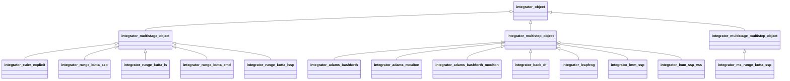

# About FOODIE

FOODIE (Fortran Object-Oriented Differential-equations Integration Environment) is a pure Fortran 2008 library for the
numerical integration in time of systems of differential equations:

$$
\begin{cases}
U_t = R(t, U) \\
U(t_0) = U_0
\end{cases}
$$

where $U_t = \frac{dU}{dt}$, $U$ is the vector of state variables, function of the time-like independent variable
$t$, $R$ is the (vectorial) residual function, possibly nonlinear in $U$, and $U_0$ the initial conditions. Such systems
are ubiquitous: pure ODEs (Lorenz attractor, inertial oscillations, chemical kinetics) and, above all, the algebraic ODE
systems obtained by discretizing in space a PDE system (method of lines). FOODIE is tailored to the latter, but it is not
limited to them.

This documentation reads in order, and each page links to the next one:

1. [Installation](./installation): build the library and get it into your project.
2. [Quick start](./quickstart): define a concrete integrand and integrate it.
3. The [catalogue of the schemes](./schemes), with the formulas of the [Runge-Kutta](./schemes-runge-kutta) and
   [multistep](./schemes-multistep) families.
4. [Testing](./testing): how the order of every scheme is verified.
5. Two worked examples: the [oscillation equations](./example-oscillation) and the
   [1D Euler equations](./example-euler-1d).

The [API](/api/) documents the source itself.

## Motivations

Many Fortran libraries for ODEs exist, but most of them are written in procedural style against Fortran 77/95: the
user packs the state in a flat array and passes a residual callback with a fixed signature, the scheme is a loop over
array indexes that does not resemble its formula. FOODIE exploits the object-oriented features of Fortran 2003/2008 to
translate the mathematical formulation of a scheme into code as directly as possible, without compromising efficiency.

FOODIE has two purposes:

- **for developers of schemes**: a concise, clear, abstract environment where a new scheme is written in a high-level
  language close to its natural mathematical formulation, which makes the implementation fast, readable and robust;
- **for users who must solve a system**: a simple, uniform API over many ready-to-use schemes, which makes the solution
  of a new problem fast and cross-validation trivial: the same problem integrated by different schemes, the same scheme
  applied to different problems.

## The abstract integrand

FOODIE is built on the *abstract calculus pattern* of Rouson, Xia and Xu (*Scientific Software Design: The
Object-Oriented Way*, Cambridge University Press, 2011), based on Abstract Data Types (ADT). Every scheme is written
against one abstract type, `integrand_object`, which declares what a state must provide:

- the residual function, the type-bound procedure `t`: `U%t(t=t)` is $R(t, U)$;
- the arithmetic between integrands and reals: `+`, `-`, `*` and the assignment `=`;
- an estimate of the local truncation error between two integrands, the operator `.lterror.` (used by the adaptive
  embedded Runge-Kutta schemes);
- a description and the dimension of the state.

With these operators the forward Euler scheme $U^{n+1} = U^n + \Delta t \, R(t^n, U^n)$ is, verbatim from
`foodie_integrator_euler_explicit.F90`:

```fortran
U = U + (U%t(t=t) * Dt)
```

The scheme does not know what `U` models (a scalar, the velocity field of a turbulent flow, a multi-fluid gas on a finite
volume grid); the integrand does not know which scheme integrates it. The user extends `integrand_object` with a concrete
type and implements its deferred procedures, see the [quick start](./quickstart).

The operators return plain arrays, `real(R_P), allocatable :: opr(:)`, not integrands: an expression such as
`U + (U%t(t=t) * Dt)` is evaluated as arrays and assigned back to the integrand by its `assign_real` procedure. Each
operation thus allocates a temporary array; for performance-critical integrands every integrator provides a *fast mode*
built on in-place procedures (`t_fast`, `add_fast`, `multiply_fast`, `subtract_fast`) that the integrand overrides.

## The integrators

The schemes are grouped in classes, each one a concrete type extending one of three abstract integrators, children of
the abstract `integrator_object`:



- **multistage** integrators (Runge-Kutta family) advance the solution from $t^n$ to $t^{n+1}$ using only $U^n$; their
  `integrate(U, Dt, t, new_Dt)` accepts an optional `new_Dt`, the step actually used by the adaptive schemes;
- **multistep** integrators (Adams, BDF, leapfrog, LMM-SSP) use the solution at several previous steps, stored inside the
  integrator; their `integrate(U, Dt, t)` requires the previous steps to be initialized (start-up);
- **multistage-multistep** integrators (multistep Runge-Kutta SSP) combine both.

Every concrete integrator is identified by its class name (e.g. `runge_kutta_ssp`) and supports a list of schemes
(e.g. `runge_kutta_ssp_stages_3_order_3`). The helper procedures of the `foodie` module expose them:

| Procedure | Purpose |
|---|---|
| `foodie_integrator_factory` | Return an initialized integrator, `class(integrator_object), allocatable`, given a scheme name |
| `foodie_integrator_class_names` | Return the names of the classes of schemes |
| `foodie_integrator_schemes` | Return the names of all the schemes, or of the schemes of one class |
| `is_available`, `is_class_available`, `is_scheme_available` | Inquire whether a scheme or a class exists |

## Status

FOODIE is in beta: many schemes are implemented and verified (see [Testing](./testing)), but the API can still change.
FOODIE has integrated problems ranging from pure ODEs (Lorenz, inertial oscillations) to PDEs (Burgers, multi-fluid Euler
equations).

## Authors

- Stefano Zaghi — [@szaghi](https://github.com/szaghi)

FOODIE is developed within the [Fortran-FOSS-Programmers](https://github.com/Fortran-FOSS-Programmers) group.
Contributions are welcome — see the [Contributing](contributing) page.

## Copyrights

FOODIE is distributed under a multi-licensing system:

| Use case | License |
|---|---|
| FOSS projects | [GPL v3](http://www.gnu.org/licenses/gpl-3.0.html) |
| Closed source / commercial | [BSD 2-Clause](http://opensource.org/licenses/BSD-2-Clause) |
| Closed source / commercial | [BSD 3-Clause](http://opensource.org/licenses/BSD-3-Clause) |
| Closed source / commercial | [MIT](http://opensource.org/licenses/MIT) |

Anyone interested in using, developing or contributing to FOODIE is welcome: pick the license that best fits your needs.
The license texts are in the repository root (`LICENSE.gpl3.md`, `LICENSE.bsd-2.md`, `LICENSE.bsd-3.md`,
`LICENSE.mit.md`).
